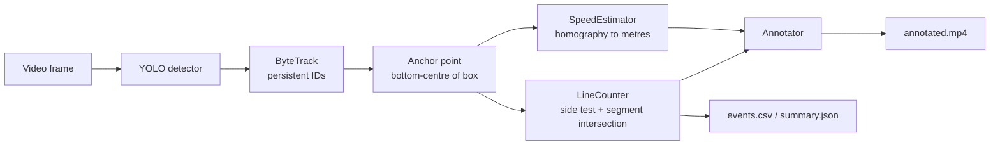

# traffic-vision

[](https://github.com/abdallahalaa13200-alt/traffic-vision/actions/workflows/ci.yml)


Real-time vehicle **detection, multi-object tracking, directional line-crossing
counts and speed estimation** from traffic video. YOLO finds vehicles in every
frame, ByteTrack links them into persistent identities, and a small, fully
tested geometry core turns those tracks into traffic statistics.

```
traffic-vision --config configs/default.yaml --source highway.mp4
```

Each run produces an annotated video, a per-vehicle event log and a JSON summary:

```json
{
  "totals": { "in": 41, "out": 37, "all": 78 },
  "by_class": {
    "car":   { "in": 33, "out": 30 },
    "truck": { "in": 6,  "out": 5 },
    "bus":   { "in": 2,  "out": 2 }
  }
}
```

<sub>Illustrative output format: real numbers depend on your video.</sub>

## Features

- **Detection + tracking**: any Ultralytics checkpoint (YOLOv8 / YOLO11, nano to
  x-large, or your own fine-tuned weights) with ByteTrack or BoT-SORT.
- **Directional counting**: a vehicle is counted when its ground-contact point
  crosses a configurable line segment, split into `in` / `out` and per class.
  Each track is counted at most once, so jitter on the line cannot inflate totals.
- **Speed estimation**: a four-point perspective calibration maps image pixels
  onto a metric ground plane, and speed is averaged over a short time window.
- **Resolution-independent config**: lines and regions are normalised `[0, 1]`
  coordinates, so one YAML works for 720p and 4K alike.
- **Reports**: `annotated.mp4`, `events.csv` (one row per crossing, with time and
  speed) and `summary.json`.
- **Tested core**: the geometry, counting, speed, config and reporting logic is
  pure Python + NumPy and covered by unit tests that run in CI without a GPU.

## How it works



**Why the bottom-centre of the box?** It is where the vehicle meets the road.
Using the box centre would make tall vehicles (buses, trucks) cross the line
earlier than cars at the same position, and would break the speed calibration,
which is defined on the road plane.

**Counting.** For the directed line `start -> end`, the sign of the 2-D cross
product says which side a point is on. A track is counted when its side flips
*and* the segment between its previous and current positions actually
intersects the counting line. The second check stops vehicles from being counted
when they change side by driving past the end of the line. A point exactly on the
line is ignored until the vehicle commits to a side.

**Speed.** Four image points outlining a real rectangle on the road (for
example, lane markings of known width and length) define a homography `H`,
solved directly as an 8x8 linear system. Each anchor point is projected through
`H` into metres, and speed is the distance travelled across a sliding window of
frames divided by the elapsed time. Estimates are only made inside the
calibrated region, where the projection is valid.

## Quickstart

```bash
git clone https://github.com/abdallahalaa13200-alt/traffic-vision.git
cd traffic-vision
python -m venv .venv && source .venv/bin/activate   # Windows: .venv\Scripts\activate
pip install -e ".[dev]"

# Put a traffic video at data/traffic.mp4 (or pass --source), then:
traffic-vision --config configs/default.yaml
```

YOLO weights are downloaded automatically on first use. Useful overrides:

```bash
traffic-vision --source 0 --show                       # webcam, live preview
traffic-vision --source clip.mp4 --weights yolo11s.pt  # larger model
traffic-vision --source clip.mp4 --line 0 0.4 1 0.4    # line at 40% of frame height
traffic-vision --source clip.mp4 --device 0            # first CUDA GPU
```

`python -m traffic_vision ...` works the same as the `traffic-vision` command.

## Configuration

All options live in [`configs/default.yaml`](configs/default.yaml); CLI flags
override the file.

| Key | Default | Meaning |
| --- | --- | --- |
| `source` | `data/traffic.mp4` | Video file, stream URL, or webcam index |
| `classes` | `[car, motorcycle, bus, truck]` | COCO class names to track |
| `model.weights` | `yolov8n.pt` | Ultralytics detection checkpoint |
| `model.conf` / `model.iou` | `0.35` / `0.5` | Detection confidence and NMS IoU thresholds |
| `model.tracker` | `bytetrack.yaml` | `bytetrack.yaml` or `botsort.yaml` |
| `line.start` / `line.end` | `[0.05, 0.6]` / `[0.95, 0.6]` | Counting line, normalised coordinates |
| `speed.enabled` | `false` | Turn on speed estimation |
| `speed.region` | 4 points | Road rectangle corners: TL, TR, BR, BL |
| `speed.width_m` / `speed.length_m` | `10.5` / `30.0` | Real size of that rectangle |
| `speed.window_s` | `0.5` | Averaging window for speed |
| `trail_length` | `30` | Frames of motion trail drawn per vehicle |

**Direction convention.** Facing from `line.start` towards `line.end`, crossing
from right to left is `in`. For a line drawn left to right across the frame,
traffic moving up the image is `in` and traffic moving down is `out`. Swap
`start` and `end` to flip it.

**Calibrating speed.** Pause a frame, pick four points on the road that form a
real rectangle (lane lines are ideal: lanes are typically 3.5 m wide, and dashed
markings have a fixed length and gap), and write them as fractions of the frame
size. Accuracy depends on how well that rectangle is measured.

## Outputs

| File | Contents |
| --- | --- |
| `runs/<name>/annotated.mp4` | Boxes, IDs, speeds, motion trails, counting line, live tally |
| `runs/<name>/events.csv` | `frame, time_s, track_id, class, direction, speed_kmh` per crossing |
| `runs/<name>/summary.json` | Totals, per-class counts, duration, processing FPS |

## Project structure

```
src/traffic_vision/
├── geometry.py   # side test, segment intersection, point-in-polygon, homography
├── counter.py    # LineCounter: per-track state machine for directional crossings
├── speed.py      # SpeedEstimator: ground-plane projection + windowed speed
├── detector.py   # YOLO + tracker wrapper -> TrackedObject
├── annotate.py   # OpenCV overlays
├── pipeline.py   # the video loop that ties everything together
├── report.py     # CSV / JSON writers
├── config.py     # typed, validated YAML config
└── cli.py        # argparse entry point
tests/            # unit tests for everything that is not the neural network
```

## Testing

```bash
pytest -q          # unit tests (no GPU or model download needed)
ruff check .       # lint
```

## Limitations

- Counts are only as good as the tracker: long occlusions can split one vehicle
  into two IDs. A higher-capacity model (`yolo11s.pt` or larger) and a line placed
  where vehicles are well separated help most.
- Speed assumes a flat road inside the calibrated region and a fixed camera.
- COCO-pretrained weights are used out of the box. For unusual viewpoints
  (top-down drones, night IR), fine-tune a detector and pass it with `--weights`.

## License

[MIT](LICENSE)
